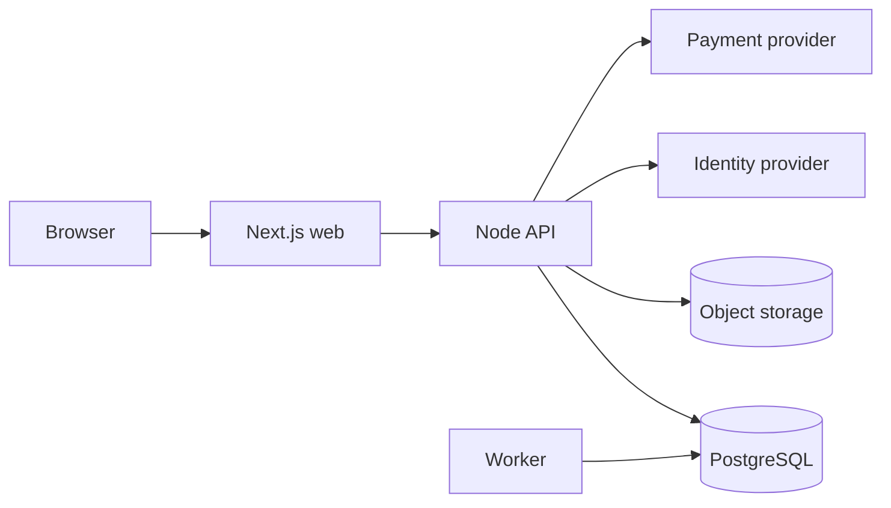

# Architecture — tasklet-alt

**This is our architecture, not a claim about Tasklet.** It designs tasklet-alt's V1 from
our requirements (`spec/PRODUCT_SPEC.md`), the architecture inferences
(`research/architecture-inference.md`) and the reconstructed domain model — nothing here describes
how Tasklet is built. Every component is justified by a requirement (`R-`), an inference
(`A-`) or a decision (`ADR-`); decisions live in `spec/decisions/`. `## Decisions` and
`## Requirement coverage` are generated (never edit between the markers).

## Overview



## Stack

| Concern | Choice | ADR |
|---|---|---|
| Web | Next.js (TypeScript) | ADR-010 |
| API and worker | Node.js (TypeScript) | ADR-010 |
| Database and jobs | PostgreSQL | ADR-005, ADR-007 |
| Sign-in | Hosted identity provider | ADR-003 |
| Files | S3-compatible object storage | ADR-008 |
| Payments | Payment provider | ADR-011 |
| Deployment | Docker on a container platform | ADR-009 |

## Components

- Web: Next.js app for boards, projects and settings (R-001, R-002, ADR-010)
- API: HTTP API with the policy module (R-008, ADR-004)
- Worker: runs queued jobs such as notifications (R-006, ADR-007)
- Database: PostgreSQL with row-level security (R-007, ADR-002, ADR-005)

## Data storage

PostgreSQL holds everything relational, the activity history and the job queue (ADR-005, ADR-007).

## Identity & tenancy

UUIDv7 keys plus per-workspace task numbers (ADR-001); one database with row-level security per workspace (ADR-002).

## Authentication

A hosted identity provider; the API verifies its tokens (ADR-003).

## Authorization

One policy module mirrors the permissions matrix (ADR-004, INV-02).

## Async processing

Transactional outbox and a PostgreSQL job queue (ADR-007, INV-05).

## Realtime

Polling every 30 s and on focus in V1 (ADR-006).

## Search

Not in V1 (SC-019).

## File storage

Object storage with signed URLs (ADR-008, INV-07).

## Integrations

Identity provider (ADR-003) and payment provider (ADR-011); third-party integrations are deferred.

## Observability

Structured logs with request and workspace IDs; error tracking for web, api and worker.

## Security

Encryption at rest (ADR-009), secrets encrypted (INV-06), authorization on every request (INV-02).

## Deployment

Docker images for web, api and worker; managed PostgreSQL and object storage (ADR-009).

## Invariants

## Repository structure

```text
tasklet-alt/
├── apps/
│   ├── web/          # Next.js UI
│   ├── api/          # HTTP API and policy module
│   └── worker/       # job runner
├── packages/
│   ├── db/           # schema, migrations, RLS policies
│   └── shared/       # types and the policy table
├── infra/
│   └── docker/
├── tests/
│   ├── integration/
│   └── e2e/
└── docs/
```

## Deviations from the target model

- Guests are not part of V1 (UD-002 decides guests are allowed, but guest access is deferred, SC-018).

## Not applicable topics

- search: global search is deferred in V1 (SC-019)

## Convention-covered requirements

- R-005: comments and mentions are plain CRUD in the API on PostgreSQL (ADR-005, ADR-010)

## Decisions

<!-- pf:generated:start decisions -->
| ADR | Decision | Topic | Status | Satisfies |
|---|---|---|---|---|
| ADR-001 | UUIDv7 keys with per-workspace task numbers | identity | accepted | R-001, R-007 |
| ADR-002 | Shared database with workspace row-level security | tenancy | accepted | R-007, R-008, A-006 |
| ADR-003 | Sign-in through a hosted identity provider | authn | accepted | R-009, A-014 |
| ADR-004 | Role checks in one policy module | authz | accepted | R-008, A-005 |
| ADR-005 | PostgreSQL as the primary store | storage | accepted | R-001, R-003, R-004, A-004, A-012 |
| ADR-006 | Polling instead of push in V1 | realtime | accepted | R-002, A-001 |
| ADR-007 | A PostgreSQL-backed job queue with an outbox | async | accepted | R-006, A-003, A-009 |
| ADR-008 | Object storage with signed URLs | files | accepted | R-010, A-010 |
| ADR-009 | Containers with managed PostgreSQL | deployment | accepted | A-011, R-007 |
| ADR-010 | TypeScript with Next.js and a Node API | other | accepted | R-001, R-005 |
| ADR-011 | Billing through a payment provider | other | accepted | R-011 |
<!-- pf:generated:end -->

## Requirement coverage

<!-- pf:generated:start coverage -->
| R | Requirement | Addressed by |
|---|---|---|
| R-001 | Tasks move through a fixed status set | ADR-001, ADR-005, ADR-010 |
| R-002 | Boards show tasks by status and stay current | ADR-006 |
| R-003 | Projects group tasks | ADR-005 |
| R-004 | Every task keeps its history | ADR-005 |
| R-005 | Members discuss tasks | ADR-010, convention |
| R-006 | Members are notified in the app | ADR-007 |
| R-007 | Workspaces hold members | ADR-001, ADR-002, ADR-009 |
| R-008 | Roles decide what members may do | ADR-002, ADR-004 |
| R-009 | Sign-in uses an identity provider | ADR-003 |
| R-010 | Files attach to tasks | ADR-008 |
| R-011 | Billing runs through a payment provider | ADR-011 |
<!-- pf:generated:end -->
